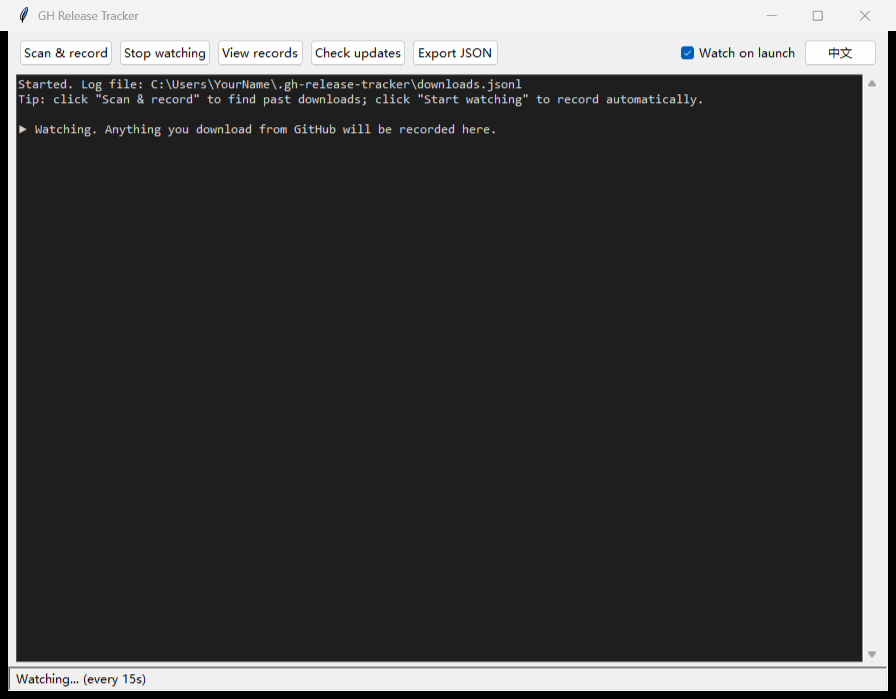
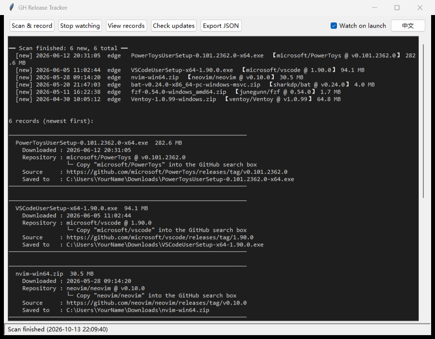
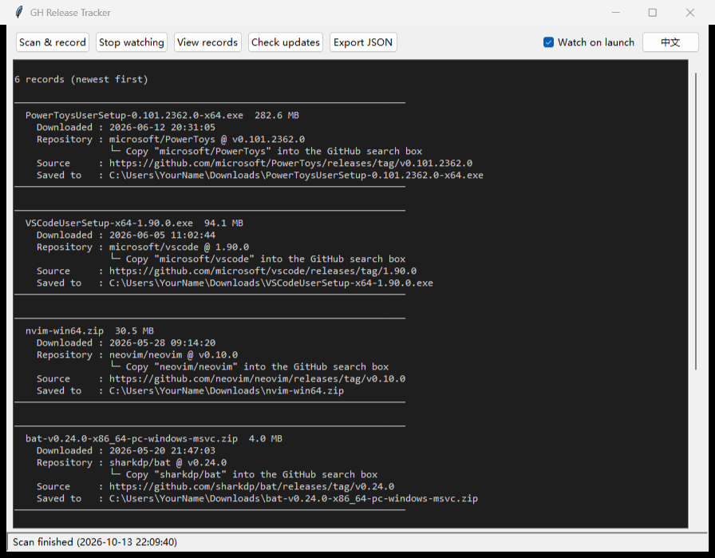
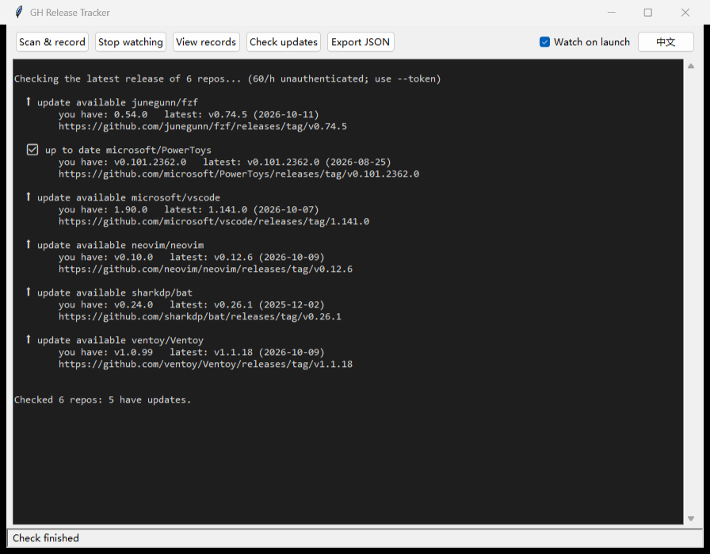

# GH Release Tracker

> A double-click Windows tool that **automatically records the GitHub releases you download — and tells you which ones have updates.**

[](https://www.python.org/)
[](LICENSE)
[]()

**English** · [中文说明](README.md)

> ⬇️ **Download:** [**GH-Release-Tracker.exe**](https://github.com/M3tamorphosis-creator/GH-Release-Tracker/releases/latest) — 12 MB, no Python needed

---

## What it is

GitHub has **no** "my downloads" page — there is no built-in way to see which releases you have downloaded. This tool records that for you, automatically:

- You download a tool from GitHub (say, PowerToys)
- It records **the file name, the repository, the version, the download time, and where it was saved**
- When that repository ships a new version, one click tells you **"there's an update"**

In one line: **it keeps an eye on what you downloaded, and what's outdated.**

> 🌐 The interface is **bilingual (English / 中文)**. Click the **中文** button at the top-right to switch.

---

## Illustrated tutorial (5 minutes)

> Mouse only — no commands to type. Every step below has a real screenshot.

### Step 1 — Double-click to launch

Double-click **`GH-Release-Tracker.exe`**.



The window is laid out like this:

| Area | What it is |
|---|---|
| Five buttons on top | Every feature lives here |
| Checkbox at the top-right | "Watch on launch" — **checked by default** |
| Button at the far right | Switches the UI language (`中文` / `English`) |
| Dark area in the middle | Where results are printed |
| Status bar at the bottom | Current state, e.g. "Watching… (every 15s)" |

**It starts watching automatically as soon as it opens** — from then on, anything you download from GitHub gets recorded for you.

> The first launch may take 2–3 seconds while the single-file exe unpacks itself. That's normal.

### Step 2 — Click **Scan & record**



After a few seconds the results appear (see above):

- The first line summarises the run — how many records were added and how many exist in total
- Below it, every download is printed as a **card**
- Each card shows: file name and size, download time, **repository (`owner/repo`) and version**, source page, and local path
- The line **`└─ Copy "owner/repo" into the GitHub search box`** is a hint: paste that repository name into GitHub's search box to open the project

### Step 3 — Click **View records**



All records are listed, newest first. You can:

- Scroll with the **mouse wheel** or the **scrollbar on the right**
- Copy any repository name and paste it into GitHub search to open that project

### Step 4 — Click **Check updates**



It asks GitHub for the latest release of every repository you downloaded, then labels each one:

| Marker | Meaning |
|---|---|
| ✅ up to date | You already have the latest version |
| ⬆ update available | A newer version exists — click the link to download it |
| ⬇ you have a newer build | Your copy is newer than GitHub's "latest" (e.g. a pre-release) |
| ? cannot compare | The tag format can't be compared (harmless, still usable) |

> In the screenshot above, 5 repositories show "update available" and 1 shows "up to date".

### Bonus — Click **Export JSON**

Saves every record as a JSON file (readable in any text editor or Excel) for backup or sharing.

---

## Buttons

| Button | What it does |
|---|---|
| **Scan & record** | Scans your download folders + browser history to backfill past downloads |
| **Start watching / Stop watching** | Watches continuously (every 15 s by default); new downloads are recorded automatically |
| **View records** | Lists all records (newest first) as cards, with the repo name on its own line and a "copy to GitHub search" hint |
| **Check updates** | Asks GitHub for the latest release of every repo you downloaded |
| **Export JSON** | Saves all records as a JSON file |
| ☑ **Watch on launch** | If checked, the app begins watching as soon as it opens |
| **中文 / English** | Switches the interface language instantly |

---

## Files

| File | Description |
|---|---|
| `GH-Release-Tracker.exe` | **The app.** Download it from [Releases](https://github.com/M3tamorphosis-creator/GH-Release-Tracker/releases/latest), then double-click. No Python required |
| `README.md` | Chinese documentation (with the tutorial) |
| `README.en.md` | This file (English) |
| `新手教程.md` | Standalone copy of the Chinese tutorial |
| `images/` | Screenshots used by the docs (`en-*.png` = English UI) |
| `gh-release-tracker-gui.pyw` | GUI source (`.pyw` = opens without a console window) |
| `gh-release-tracker.py` | Core logic + CLI (the exe also calls it) |
| `scan-github-downloads.py` | Legacy one-off forensic scanner |
| `start.bat` | Legacy console launcher |

**Where the data lives**: `C:\Users\<you>\.gh-release-tracker\downloads.jsonl` (one JSON object per line). Back this file up and your history survives a reinstall.

---

## FAQ / Troubleshooting

| Problem | Fix |
|---|---|
| "Windows protected your PC" on launch | Click **More info → Run anyway**. This is the standard warning for unsigned executables |
| Flagged by antivirus | Add it to your allow-list. PyInstaller-built executables are occasionally false-flagged |
| Slow first launch | The single-file exe unpacks itself; later launches are fast |
| Where is my data? | See `downloads.jsonl` above |
| Moving to a new PC | Copy `downloads.jsonl` to the same path on the new machine |

---

## CLI (advanced)

The GUI is just a wrapper around the CLI, which is handy for scripts and scheduled tasks:

```bash
python gh-release-tracker.py            # auto: scan, print, then keep watching
python gh-release-tracker.py scan       # one-off backfill
python gh-release-tracker.py watch      # watch continuously
python gh-release-tracker.py list       # list records
python gh-release-tracker.py check      # check for updates
```

Common options: `--log PATH`, `--dirs D1 [D2 ...]`, `--interval N`, `--token <PAT>`, `--lang en|zh`.

You can also set the output language with the `GHRT_LANG` environment variable (e.g. `set GHRT_LANG=en`).

---

## Rebuilding the exe from source

Requires Python 3.8+ and PyInstaller:

```bash
pip install pyinstaller
python -m PyInstaller --noconfirm --onefile --windowed --name "GH-Release-Tracker" --add-data "gh-release-tracker.py;." "gh-release-tracker-gui.pyw"
```

The executable is written to `dist\GH-Release-Tracker.exe`.

---

## How it works

GitHub doesn't expose your personal download history, so the tool reconstructs it from **two local traces**:

1. **Browser download history** — the `downloads` table in Edge / Chrome's `History` database (exact time, size, source page)
2. **Windows Mark-of-the-Web** — the `Zone.Identifier` alternate data stream on the downloaded file (the original URL)

The two sources are cross-checked, de-duplicated by path, and appended to `downloads.jsonl`. Noise such as extracted archive contents and deleted files is filtered out.

---

## 🔒 Privacy

| What it accesses | Why | Leaves your machine? |
|---|---|---|
| Browser download history (Edge / Chrome `History`) | To identify GitHub downloads | ❌ read-only, local |
| Mark-of-the-Web (`Zone.Identifier`) | Fallback for the original download URL | ❌ read-only, local |
| `~/.gh-release-tracker/downloads.jsonl` | Stores your records | ❌ local only |

**The only network call**: when you click "Check updates", it sends a single HTTPS GET to `https://api.github.com/repos/<repo>/releases/latest`.

- Apart from the **repository name** (which is part of the URL), **nothing is uploaded** — no file names, paths, timestamps, or account data
- With `--token`, the token is sent only to `api.github.com` and is **never stored or logged**
- It does **not** read your passwords, cookies, or credentials

**The record file is sensitive**: `downloads.jsonl` contains your full download history and local paths (including your Windows username). Sanitise it before sharing.

> 💡 The source is fully auditable, uses **only the Python standard library** at runtime, has no third-party dependencies, and performs no background uploads or telemetry.

---

## Known limitations

- **Deleted files may be missed** — only downloads that still exist on disk with traces are detected
- **Not every downloader is covered** — browser downloads work best; tools that write no Mark-of-the-Web and bypass the browser may not be recorded
- **Windows-oriented** — Mark-of-the-Web is a Windows feature; the GUI and watcher target Windows
- **Version comparison is heuristic** — it compares leading numeric segments; unusual tags are reported as "cannot compare"
- **Mirror downloads may not resolve a repo** — downloads from third-party mirrors sometimes can't be mapped back to an `owner/repo`

---

## License

MIT
