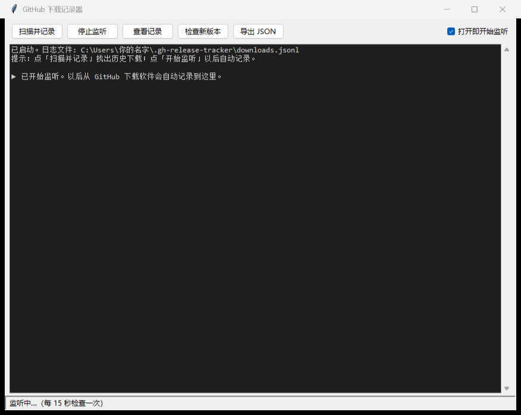
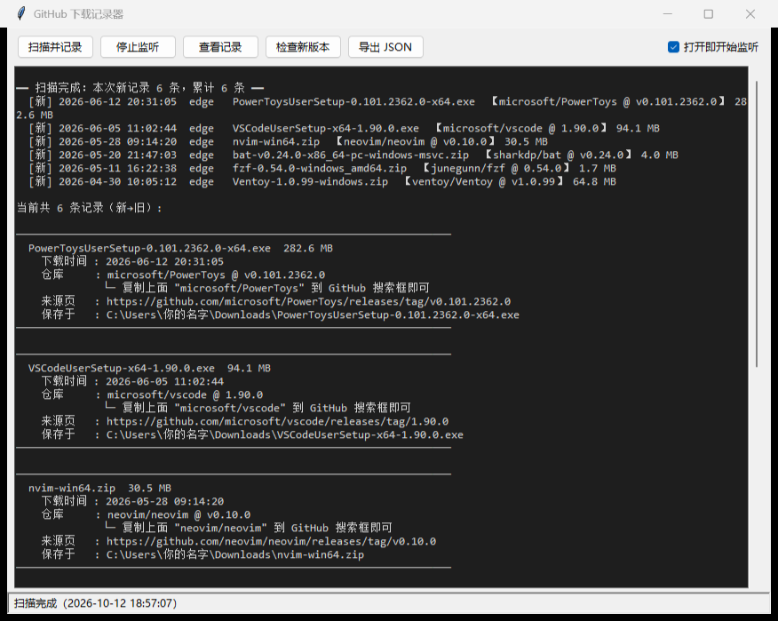
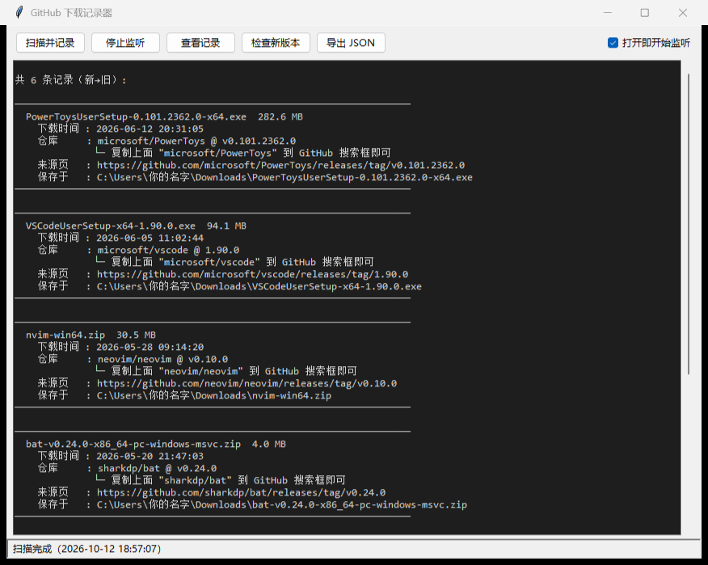
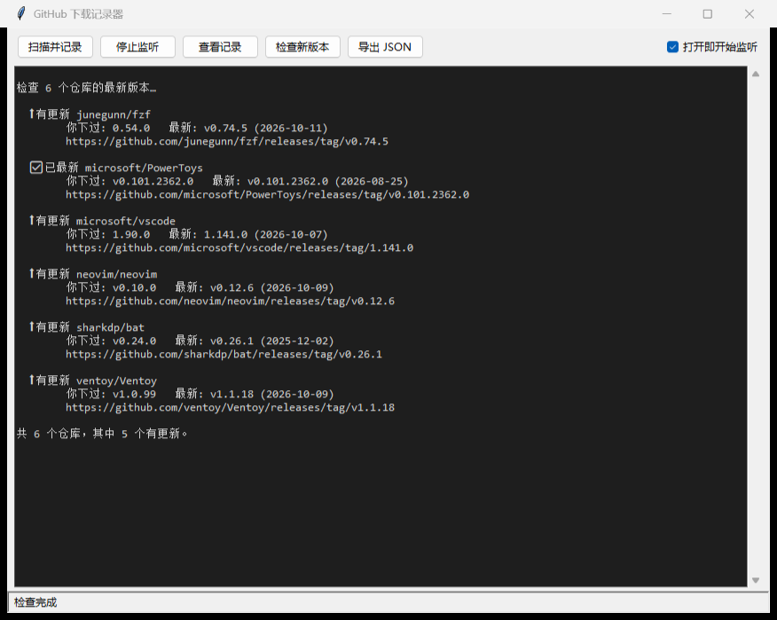

# 新手教程（图文版）

> 跟着点就行，**全程鼠标操作，不用敲任何命令**。

---

## 第 1 步：双击打开软件

在桌面上找到 **`GH-Release-Tracker.exe`**，双击它。

打开的窗口就是上图这样，各部分是：

| 位置 | 是什么 |
|---|---|
| 顶部 5 个按钮 | 全部功能入口，下面几步逐个用 |
| 右上角勾选框 | 「打开即开始监听」，**默认已勾选** |
| 中间深色区域 | 显示结果的地方 |
| 底部状态栏 | 显示当前状态，例如「监听中…（每 15 秒检查一次）」 |

打开后它**已经自动开始监听**了——以后你从 GitHub 下载软件，它会自动记下来，你不用管。

> 首次启动会慢 2~3 秒（单文件程序要先解压），属正常现象。

---

## 第 2 步：点「扫描并记录」，把以前下过的找出来

点顶部的「**扫描并记录**」按钮。

等几秒，结果就打印出来了（见上图）：

- 第一行告诉你 **本次新记录 6 条、累计 6 条**
- 下面是一条条记录，用**卡片**排版
- 每张卡片包含：文件名和大小、下载时间、**仓库（owner/repo）和版本**、来源页、保存在哪
- 卡片里那行 **`└─ 复制上面 "owner/repo" 到 GitHub 搜索框即可`**，就是提示你：把仓库名复制到 GitHub 搜索框，就能打开对应项目

---

## 第 3 步：点「查看记录」，随时看全部

点「**查看记录**」按钮，会列出全部记录（新的在上面）。

然后你可以：

- 用**鼠标滚轮**或**右侧滑动条**上下翻阅
- 复制任意一条的仓库名，粘到 GitHub 搜索框，直接打开那个项目

---

## 第 4 步：点「检查新版本」，看哪些该更新了

点「**检查新版本**」按钮。

它会把每个下过的仓库都去 GitHub 问一遍最新版，然后标出状态：

| 标记 | 含义 |
|---|---|
| ✅ 已最新 | 你下的就是最新版，放心 |
| ⬆ 有更新 | 出新版本了，点下面的链接去下载 |
| ⬇ 你下过更新版 | 你下的比 GitHub 上的"最新"还新（比如预发布版） |
| ？ 无法比较 | 版本号格式特殊，比不出来（不影响使用） |

> 上图里就有 5 个仓库显示「**有更新**」（fzf、vscode、neovim、bat、Ventoy），还有 1 个显示「**已最新**」（PowerToys）。

---

## 额外：点「导出 JSON」把记录存成文件

点「**导出 JSON**」，可以把全部记录存成一个 JSON 文件（用记事本或 Excel 都能打开），方便备份或转发。

---

## 常见问题

| 问题 | 怎么办 |
|---|---|
| 双击提示「Windows 已保护你的电脑」 | 点「更多信息 → 仍要运行」 |
| 首次启动慢 | 单文件程序要先解压，等 2~3 秒即可 |
| 界面一闪一闪 / 滚不动 | 用最新版 exe（此问题已修复） |
| 记录存在哪 | `C:\Users\你的用户名\.gh-release-tracker\downloads.jsonl` |
| 换电脑怎么迁移 | 把这个 `downloads.jsonl` 拷到新电脑的同名位置即可 |

---

← 返回 [README](README.md)
